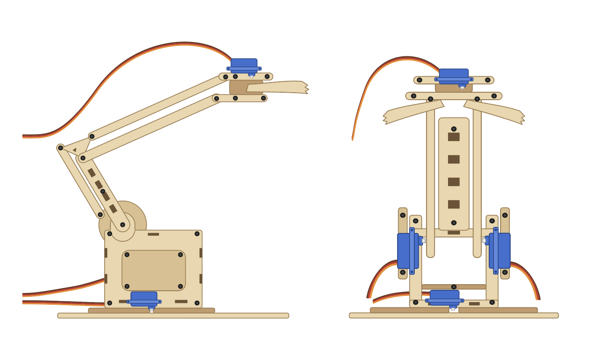
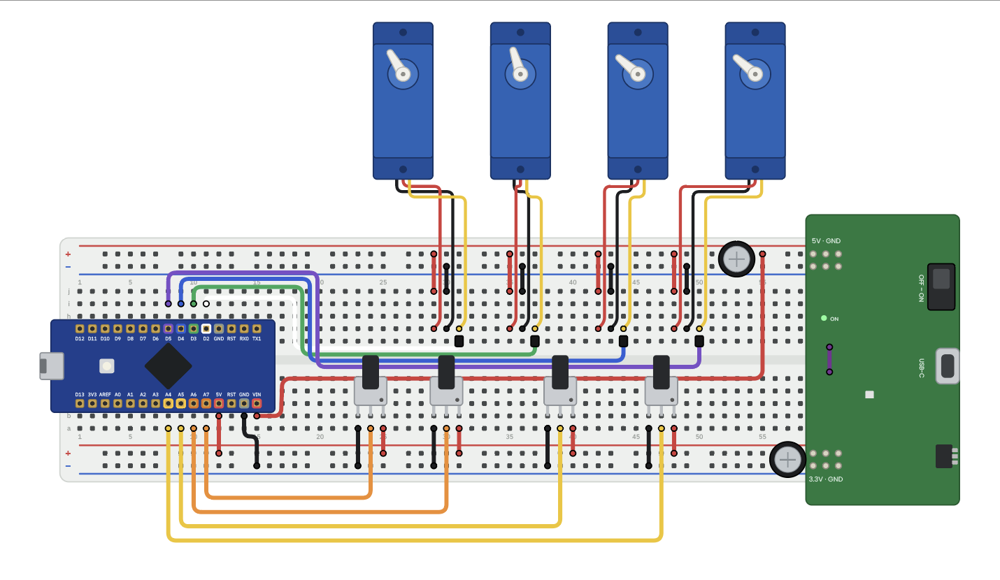
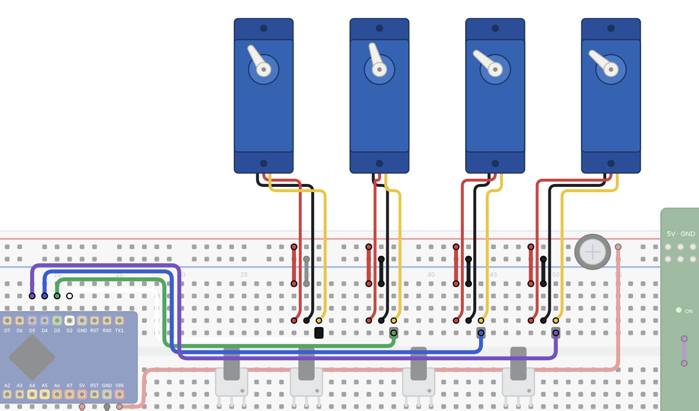
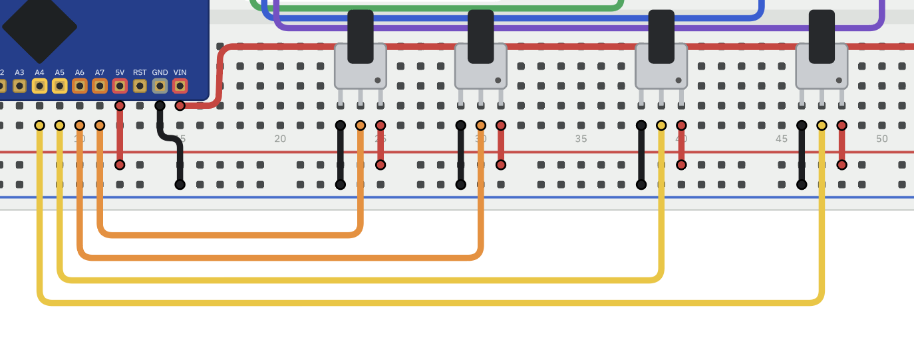
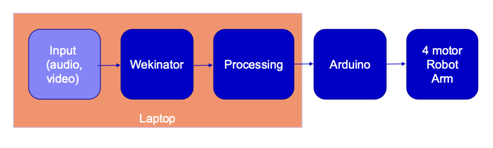
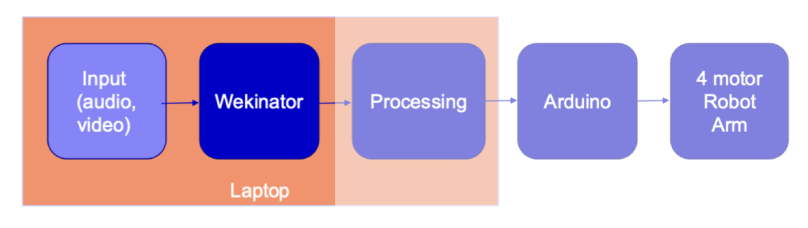
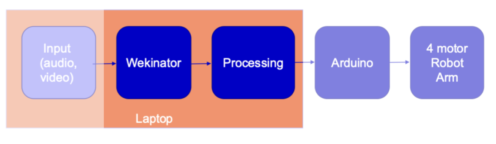
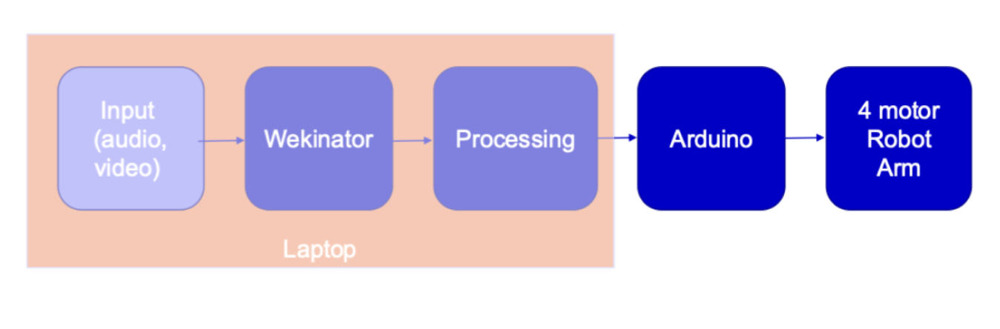
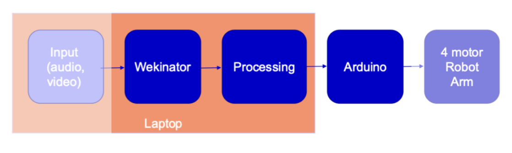

[PHYSICAL INSPECTION](#physical-inspection) · [WIRING VERIFICATION CHECKLIST](#wiring-verification-checklist) · [SYSTEM SETUP](#system-setup) · [UNIT TESTING](#unit-testing)

---

## PHYSICAL INSPECTION

> *Perform these checks with the power disconnected.*

  

### 1. Inspect the mechanical components

- [ ] Does the wooden base contain any cracks / loose or panels?
- [ ] Are all screws and joints secure?
- [ ] Are wooden parts splitting around screw holes?
- [ ] Is the arm stable on a flat surface?

### 2. Check the joints and linkages

- [ ] Identify each moving joint from the base upwards to the head.
- [ ] Check that servo paddles are firmly attached and linkages are not bent or catching.
- [ ] With power disconnected, gently check the range of servo motion.

### 3. Inspect wiring and power

- [ ] Check each servo cable for loose connectors / trapped wires.
- [ ] Make sure moving joints cannot pull cables tight or pinch them against the wooden parts.
- [ ] Disconnect power before changing connections.

---

## WIRING VERIFICATION CHECKLIST

> *Perform these checks with the power disconnected.*
>
> *Use the original schematic and code to complete the pin assignments. Do not guess pin numbers.*

  

### 4. Power and ground

* Check that positive (red) and ground (black) rails connect to the intended supply outputs according to the schematic
* Check that positive and ground rails are not accidentally bridged.

  

### 5. Four servo motors

* Trace each servo's signal wire to its assigned controller pin in the schematic.
* Verify each servo's power and ground wires connect to the correct rails.
* Check that no signal wire is accidentally connected to a power rail.

  

### 6. Four Potentiometers

* Trace each potentiometers pins and associated wires against the schematic.
* Verify each button input connects to the intended controller pin.

### 7. Controller and breadboard

* Match every jumper wire to its labelled controller pin.
* Check that wires are inserted into the intended breadboard rows and power rails according to the schematic

---

## SYSTEM SETUP

### Arduino Preparation

1. Connecting your computer to the Arduino Nano via a mini-B USB \<\> USB A cable
   1. Insert the mini-B USB connector into the Arduino Nano
   2. Insert the USB A connector into your computer
2. Download the [Arduino IDE](https://www.arduino.cc/en/software) software
3. Open Arduino IDE
4. Open the file ‘[WekinatedRobotArm\_V1.ino](#tba)’
5. Go to **“Tools”** \> **“Board”** and select the Arduino Nano Every board
6. On the bottom left of the IDE, note the code provided regarding the board location
7. Select the port that your Arduino Nano Every board is connected to
8. On the dropdown box at the top of the IDE window, ensure that the Arduino Nano is selected
9. On the top left of the IDE window, click the tick button(**“verify”**)
10. On the top left of the IDE window, click the arrow button (**“upload”**)
11. Plug in the external battery source to your motor driver USB C \<\> USB A
12. Ensure the motor driver switch is ‘on’

### Processing Preparation

1. Download the [Processing IDE](https://processing.org/download/) software
2. Open the sketch ‘[processing\_osc\_to\_arduino.pde](processing/sketch_261013b/sketch_261013b.pde)’
3. On the top left of the IDE, click the play button (**“run”**), and then once everything has loaded, click the stop button (**“stop”**)
4. At the bottom of your IDE, scrolling to the top of the black console window will show your ‘available serial ports’, find and note down the port number that corresponds to the same board location in (6) <a href="#arduino-preparation">[Arduino Set Up]</a> above.
5. Returning to your sketch, where it notes **“`Serial.list()[x]`”** ensure the x is replaced with the relevant port number noted in (4),
6. Where the sketch states **“`oscP5 = new OscP5(this, y)`”** note y for future reference.

### Wekinator Preparation

1. Download the Wekinator and mouse input software
2. Open the mouse input software, and ensure that as you move the green square around the black window, the corresponding coordinates change.
3. Open Wekinator

> **NOTE:** If existing Robot Arm training model is available, skip steps 4-6

4. Fill in the following details, and then click **“Next \>”**
   1. \# inputs: 2
   2. \# outputs: 1
   3. \# classes: 9
   4. Port: enter ‘y’ from (6) <a href="#processing-preparation">[Processing]</a> above.
5. Click **‘Start Recording’** while the numerical dropdown \= 1, and returning to your mouse input window, move the green box around in an area you’d like associated with that class. Click **‘Stop Recording’**. Proceed to change the numerical dropdown and repeat for all 9 classes.
6. Click **‘Train’** and wait until finished.

### Controlling Robot Arm

1. Open your Processing IDE
   1. On the top left of the IDE, click the play button (**“run”**), and wait until everything has loaded.
2. Open Wekinator
   1. Click **‘Run’**
3. Open your mouse input software and move the green cube to your desired class locations

---

## UNIT TESTING

The following diagram taken from the Cyber Physical Systems module details the communication pathway between the digital input to eventual physical movement output seen in the 4 motor robot arm.

  

### Unit Testing \- Input to Wekinator

  

**Test Description:** To validate the effective reception of the training data by Wekinator use the following steps.

**Test Steps:**

1. Open the Wekinator app
2. Click File \> Open project
3. Select the [RobotArmTraining.wekproj](wekinator/RobotArmTraining.wekproj) file
4. Launch the Simple\_Mouse\_DraggedObject\_2Inputs app
5. Move the green box around the screen within Simple\_Mouse\_DraggedObject\_2Inputs app and verify that the Wekinator file output updates to the corresponding expected numerical region the green box is located within. Expected Wekinator output to green box position pairing listed below.
   - [ ] Output 1 \- Bottom Right
   - [ ] Output 2 \- Top Left
   - [ ] Output 3 \- Middle Right
   - [ ] Output 4 \- Middle Left
   - [ ] Output 5 \- Bottom Left
   - [ ] Output 6 \- Top Right
   - [ ] Output 7 \- Bottom Center
   - [ ] Output 8 \- Top Center
   - [ ] Output 9 \- True Center

### Unit Testing \- Wekinator to Processing

  

**Test Description:** To validate the communication between the Wekinator and Processing app, use the following the steps.

**Test Steps:**

1. Open the Simple\_Mouse\_DraggedObject\_2Inputs app
2. Open the [RobotArmTraining.wekproj](wekinator/RobotArmTraining.wekproj) file in Wekinator
3. Open the [processing\_osc\_to\_arduino.pde](processing/sketch_261013b/sketch_261013b.pde) file in Processing
4. Run the Wekinator file and Processing file
5. Verify that moving the green box to each of the 9 specified regions within the Wekinator input file is reflected in the most recent Console line in the Processing app (i.e. moving the green box to the Bottom Center of the Simple\_Mouse\_DraggedObject\_2Input, generated the following message line in the Processing console: *\#\#\# received an osc message /test with typetag f. values: 7.0*)

### Unit Testing \- Arduino to Robot Arm (Digital Control)

  

**Test Description:** To validate the functional output of the servos from the Arduino Nano Every use the following steps.

**Test Steps:**

1. Open the [SweepUnitTest.ino](#tba) file in the Arduino IDE
2. Validate then Upload the sketch to the Arduino Nano Every
3. Verify each of the 4 servo motors sweeps their full range of motion
**4a.** If all 4 servo move as expected, test is complete
**4b.** If any of the 4 servos do not sweep their full range of motion, check the following:

- [ ] Are all wires in the circuit correctly connected?
  - [ ] Is the connection cable between the Arduino Nano Every and laptop properly connected?
  - [ ] Is the correct Board and Port selected in the Arduino IDE?

### Unit Testing \- Input to Robot Arm (Messaging Functioning and Arduino Output)

  

**Test Description:** To validate the system function from ML input to expected output from Arduino (servo-driven robot movement) use the following steps. To validate the messaging functionality between Wekinator and Arduino via Processing verify that the above listed unit tests as well as this one all pass as expected.

**Test Steps:**

1. Follow the ReadMe setup instructions in the [System Setup](#system-setup) section to ensure all applications are running and begin controlling robot arm by moving the green box in the Simple\_Mouse\_DraggedObject\_2Input application
2. If any issues arise, pay attention to:
   1. [TBA]
